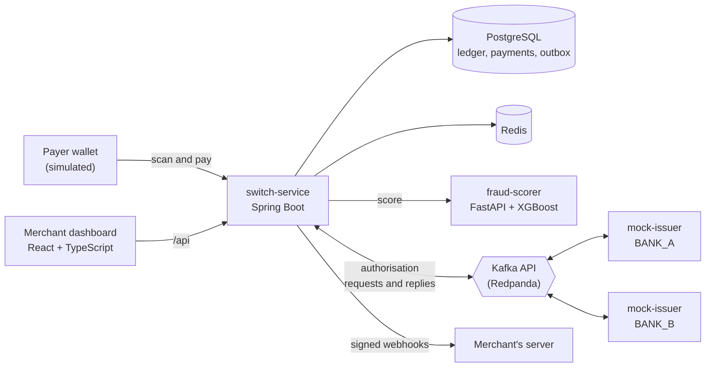

# QR Payment Switch

[](https://github.com/LAKWAN194/qr-payment-switch/actions/workflows/ci.yml)


**A LankaQR-style payment switch with real-time fraud scoring.** Merchants get EMV
QR codes, payers scan and pay, the switch routes each authorisation to an issuer
bank over Kafka, records every rupee in a double-entry ledger, and scores each
payment for fraud while it waits.

> Built from the public EMVCo merchant-presented QR specification, which LANKAQR
> follows. It is not affiliated with LankaPay or LankaClear, and no real money moves.

**Status: week 0 of 8, skeleton.** The build, CI, local infrastructure and test
harness all work. The payment logic does not exist yet. See the
[roadmap](docs/roadmap.md).

## What it will do

- Generate and parse **EMV merchant-presented QR payloads** with hand-written TLV
  and CRC code.
- Accept payments safely: **idempotency keys**, a **state machine**, and correct
  behaviour under concurrent requests.
- Keep a **double-entry ledger**, where every movement of money balances.
- Route authorisations to **two mock issuer banks over Kafka**, with timeouts,
  reversals and a **transactional outbox**.
- Score fraud with **XGBoost** on the payment path, behind a circuit breaker with
  a written failure policy.
- Send merchants **HMAC-signed webhooks** with retries and a dead-letter queue.
- **Settle and reconcile** with the banks nightly, and report every mismatch.
- Show it all in a **React merchant dashboard** with OIDC login.

## Architecture (target)



The boxes come from the project brief. How they talk (topics, timeouts, retries,
failure policies) is decided in [decision records](docs/adr/README.md) as the
project goes.

## Repository layout

| Path | What it is |
| --- | --- |
| `switch-service/` | The switch: merchants, payments, ledger, routing, outbox, webhooks, reconciliation (Java 21, Spring Boot 4.1) |
| `switch-service/.../qr/` | **The kernel**: EMV QR codec and CRC, written by hand ([rules](docs/design/kernel.md)) |
| `mock-issuer/` | A simulated issuer bank; runs twice, as BANK_A and BANK_B |
| `fraud-scorer/` | Fraud scoring service and training code (Python, FastAPI, XGBoost) |
| `merchant-dashboard/` | Merchant dashboard (React, TypeScript, Vite) |
| `tools/` | Synthetic transaction generator and k6 load tests |
| `docker/`, `compose.yaml` | Images and the local stack |
| `docs/` | Brief, roadmap, spec notes, designs, decision records, test plan |

## Quick start

Needs JDK 21, Docker, Python 3.12 and Node 22 ([details](docs/runbook.md)).

```bash
make up          # build and start everything in Docker
curl localhost:8180/actuator/health
open http://localhost:8184           # dashboard
```

Or run the pieces yourself:

```bash
make infra-up    # PostgreSQL, Redpanda, Redpanda Console, Redis
make run-switch  # switch-service on :8180
make setup       # Python venv and npm packages
make test        # every test: Java (with Testcontainers), Python, dashboard
```

`make help` lists everything.

## Roadmap

| Week | Focus |
| --- | --- |
| 0 | Skeleton, CI, local stack *(done)* |
| 1 | Ledger schema and data model |
| 2 | Kernel: EMV QR codec and CRC; merchant onboarding |
| 3 | Payments: idempotency keys, state machine, concurrency |
| 4 | Kafka routing to issuers, outbox, timeouts and reversals |
| 5 | Fraud model and scoring on the payment path |
| 6 | Signed webhooks, retries, settlement and reconciliation |
| 7 | Dashboard, login, full Docker stack, load test |
| 8 | Security pass, write-up, demo |

Details, decisions due and "done when" checks are in [docs/roadmap.md](docs/roadmap.md).

## Documentation

Start with the [brief](docs/brief.md). Everything else is indexed in
[docs/](docs/README.md).

## Licence

MIT. See [LICENSE](LICENSE).
